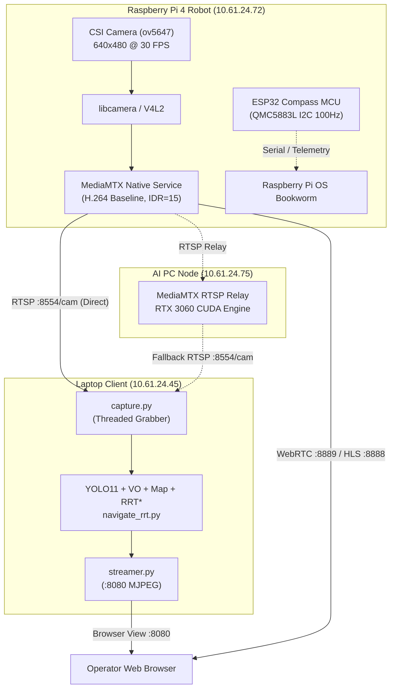
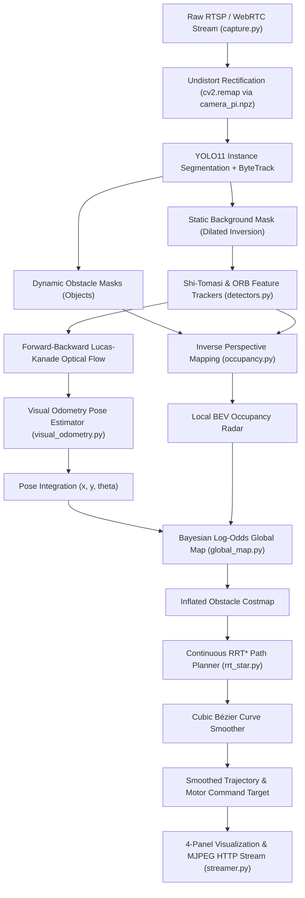
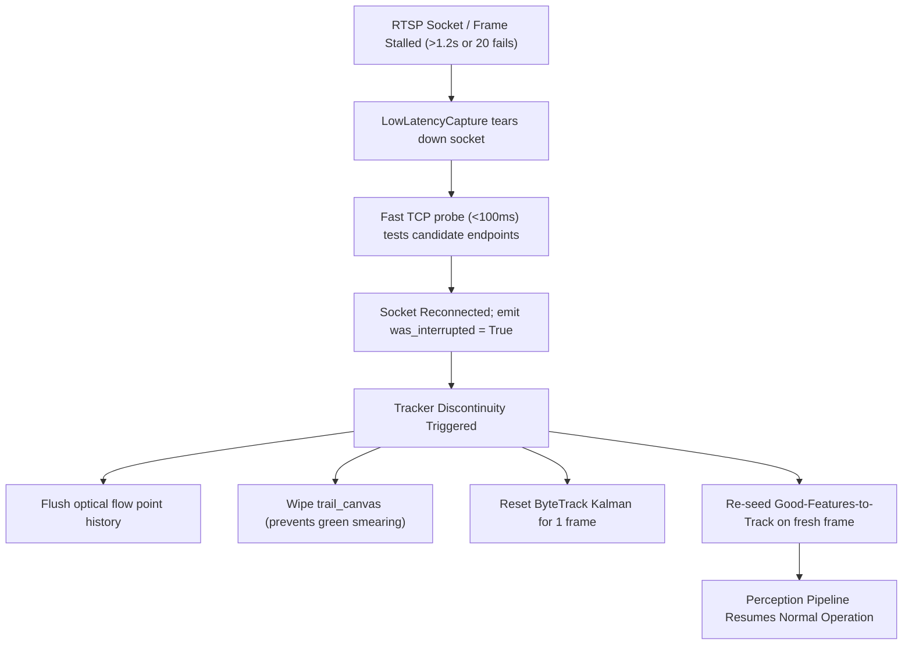

# FIBO Autonomous Robot Navigation & Visual Tracking System
## Comprehensive Technical Documentation

**Project Name:** FIBO Reoptimized Tracking & Autonomous Navigation  
**Target Platform:** Mobile Differential-Drive Robot (Raspberry Pi 4, ESP32, Dynamixel Actuators, CSI Camera)  
**Host / Client:** Windows 11 Laptop (Local Viewer & Controller) & Distributed AI GPU PC  
**Author / Organization:** Institute of Field Robotics (FIBO), King Mongkut's University of Technology Thonburi (KMUTT)  
**Date:** October 2026  
**Document Version:** 2.0.0  

---

## Table of Contents

1. [Executive Summary & System Overview](#1-executive-summary--system-overview)
2. [Hardware & Network Architecture](#2-hardware--network-architecture)
   - [2.1 Distributed Compute Network Topology](#21-distributed-compute-network-topology)
   - [2.2 Hardware Components & Sensor Suite](#22-hardware-components--sensor-suite)
   - [2.3 Coordinate Frames & Kinematics](#23-coordinate-frames--kinematics)
3. [Software Pipeline Architecture](#3-software-pipeline-architecture)
   - [3.1 High-Level Perception & Navigation Pipeline](#31-high-level-perception--navigation-pipeline)
   - [3.2 Multi-Threaded Data Flow & Concurrency Model](#32-multi-threaded-data-flow--concurrency-model)
4. [Mathematical Formulations & Algorithms](#4-mathematical-formulations--algorithms)
   - [4.1 Inverse Perspective Mapping (IPM) Homography](#41-inverse-perspective-mapping-ipm-homography)
   - [4.2 Optical Flow & Rigid Partial Affine Ego-Motion Estimation](#42-optical-flow--rigid-partial-affine-ego-motion-estimation)
   - [4.3 Ground-Plane Grounded Monocular Visual Odometry](#43-ground-plane-grounded-monocular-visual-odometry)
   - [4.4 Bayesian Log-Odds Probabilistic Occupancy Grid](#44-bayesian-log-odds-probabilistic-occupancy-grid)
   - [4.5 RRT* Path Planning & Asymptotic Optimality](#45-rrt-path-planning--asymptotic-optimality)
   - [4.6 Continuous Curvature Cubic Bézier Curve Smoothing](#46-continuous-curvature-cubic-bézier-curve-smoothing)
5. [Detailed Component & File Analysis](#5-detailed-component--file-analysis)
   - [5.1 Frame Acquisition & Self-Healing: `capture.py`](#51-frame-acquisition--self-healing-capturepy)
   - [5.2 Optical Flow & Dynamic Feature Trackers: `detectors.py`](#52-optical-flow--dynamic-feature-trackers-detectorspy)
   - [5.3 Local Bird's-Eye-View (BEV) Occupancy Radar: `occupancy.py`](#53-local-birds-eye-view-bev-occupancy-radar-occupancypy)
   - [5.4 Monocular Visual Odometry & Sensor Fusion: `visual_odometry.py`](#54-monocular-visual-odometry--sensor-fusion-visual_odometrypy)
   - [5.5 Persistent 2D Bayesian Global Map: `global_map.py`](#55-persistent-2d-bayesian-global-map-global_mappy)
   - [5.6 RRT* Planner & Bézier Smoother: `rrt_star.py`](#56-rrt-planner--bézier-smoother-rrt_starpy)
   - [5.7 Integrated Autonomous Navigation Dashboard: `navigate_rrt.py`](#57-integrated-autonomous-navigation-dashboard-navigate_rrtpy)
   - [5.8 4-Panel Perception & Tracking Engine: `yolo_mask_track.py`](#58-4-panel-perception--tracking-engine-yolo_mask_trackpy)
   - [5.9 Zero-Bloat MJPEG Web Server: `streamer.py`](#59-zero-bloat-mjpeg-web-server-streamerpy)
   - [5.10 Hardware Embedded Electronic Compass Driver: `esp32_compass.ino`](#510-hardware-embedded-electronic-compass-driver-esp32_compassino)
   - [5.11 Camera Calibration & Intrinsic Parameters: `camera_pi.npz`](#511-camera-calibration--intrinsic-parameters-camera_pinpz)
   - [5.12 Video Streaming & MediaMTX Configuration: `mediamtx_pi.yml`](#512-video-streaming--mediamtx-configuration-mediamtx_piyml)
   - [5.13 Batch Launchers & Operational Scripts](#513-batch-launchers--operational-scripts)
6. [Operational Workflows & Quick Start](#6-operational-workflows--quick-start)
   - [6.1 Setup & Prerequisites](#61-setup--prerequisites)
   - [6.2 Simulation Mode (Laptop Webcam)](#62-simulation-mode-laptop-webcam)
   - [6.3 Live Robot Operation (Raspberry Pi RTSP)](#63-live-robot-operation-raspberry-pi-rtsp)
   - [6.4 Interactive UI & Keyboard Controls](#64-interactive-ui--keyboard-controls)
7. [Diagnostics, Self-Healing & Anomaly Recovery](#7-diagnostics-self-healing--anomaly-recovery)
8. [Future Enhancements & Engineering Roadmap](#8-future-enhancements--engineering-roadmap)

---

## 1. Executive Summary & System Overview

The **FIBO Reoptimized Tracking & Autonomous Navigation System** is a real-time, low-latency perception, state estimation, mapping, and motion-planning suite engineered for differential-drive ground mobile robots.

The system integrates:
1. **Dynamic YOLO11 Instance Segmentation with ByteTrack**: Detects and tracks dynamic obstacles (humans, chairs, robots, obstacles) while isolating dynamic pixels.
2. **Dynamic Exclusion Masking**: Eliminates feature tracking on moving objects to prevent visual odometry corruption.
3. **Dual Feature Trackers (Shi-Tomasi & ORB) with Lucas-Kanade Optical Flow**: Tracks static background environmental features with forward-backward verification and sudden-jump reset protection.
4. **Inverse Perspective Mapping (IPM) Local BEV Radar**: Projects perspective camera views into metric Bird's-Eye-View (BEV) occupancy grids with column-sweep obstacle line-of-sight extrusion.
5. **Ground-Plane-Grounded Monocular Visual Odometry (VO)**: Estimates robot metric translation and yaw heading from optical flow, calibrated via camera intrinsic parameters ($K$, $dist$) and mounting geometry, with hardware IMU and ToF calibration support.
6. **Persistent 2D Bayesian Log-Odds Global Map**: Accumulates local BEV observations into an 8m $\times$ 8m metric global map with probabilistic evidence updating, minimum-motion gating, and robot footprint safety inflation.
7. **Continuous RRT* Path Planner with Cubic Bézier Smoothing**: Calculates optimal collision-free routes to arbitrary targets with $C^1$-continuous Bézier curves tailored to non-holonomic differential-drive kinematics.
8. **Resilient Hardware & Networking Infrastructure**: Zero-backlog RTSP frame grabbing with active TCP probing, auto-reconnect failover, MediaMTX native libcamera H.264 streaming, and dedicated ESP32 QMC5883L digital compass firmware.

---

## 2. Hardware & Network Architecture

### 2.1 Distributed Compute Network Topology

All participating machines reside on a dedicated high-speed local area network (`10.61.24.0/24`), ensuring sub-millisecond network latency and direct peer-to-peer socket connections without routing overhead.



#### Network Device Matrix

| Device | Role | IP Address | Operating System | Primary Hardware / Compute | Access Method |
| :--- | :--- | :--- | :--- | :--- | :--- |
| **Laptop (Client)** | Master Navigation, SLAM & GUI | `10.61.24.45` | Windows 11 | Intel Core i7 / NVIDIA RTX 4050 | Host Workspace |
| **Raspberry Pi 4** | Sensor Host & Video Server | `10.61.24.72` | Debian 13 Bookworm arm64 | Broadcom BCM2711, 4GB RAM, CSI ov5647 | `ssh pi` (ED25519) |
| **AI PC** | Heavy GPU Processing / Relay | `10.61.24.75` | Windows 11 | AMD Ryzen / NVIDIA RTX 3060 12GB | `ssh pc` (ED25519) |
| **ESP32 Node** | Magnetometer / AHRS Coprocessor | USB Serial | FreeRTOS / Arduino | ESP32-WROOM-32 (240MHz Dual-Core) | 115200 Baud UART |

### 2.2 Hardware Components & Sensor Suite

1. **Vision System**:
   - Camera: OmniVision ov5647 5MP CSI sensor mounted at height $h = 0.20\,\text{m}$ with a downward pitch angle $\theta_p = 15.0^\circ$.
   - Field of View (FOV): ~62° horizontal, ~48° vertical.
   - Operating Resolution: $640 \times 480$ pixels @ 30 FPS.
2. **Attitude / Compass Coprocessor**:
   - ESP32 micro-controller connected over I2C (GPIO 21 SDA, GPIO 22 SCL) to a QMC5883L 3-axis digital magnetometer IC.
   - 100 Hz output data rate, $\pm 8\,\text{Gauss}$ dynamic range, 512 oversampling ratio.
   - Firmware implements dual hard-iron offset and soft-iron axial scaling calibration.
3. **Mobility Subsystem**:
   - Differential-drive mobile chassis with left and right drive wheels driven by Robotis Dynamixel smart actuators.
   - Effective robot physical collision radius: $r_{robot} = 0.15\,\text{m} - 0.18\,\text{m}$.
   - Wheel track width: $0.28\,\text{m}$.

### 2.3 Coordinate Frames & Kinematics

The system maintains three principal coordinate reference frames:

1. **World Frame $\{W\}$**: Fixed right-handed Cartesian coordinate frame with metric units (meters).
   - Origin $(0, 0)$ is centered in the persistent global occupancy grid.
   - $+X_W$: Lateral / East.
   - $+Y_W$: Longitudinal / North (Forward reference).
   - $\theta_W$: Robot heading angle in radians ($\theta = \frac{\pi}{2}$ points along $+Y_W$).
2. **Robot Local Frame $\{R\}$**: Moving reference frame centered at the midpoint between the robot's differential drive wheels.
   - $+X_R$: Lateral axis (positive to the robot's right).
   - $+Y_R$: Forward longitudinal heading axis (straight ahead).
   - Robot pose in $\{W\}$ is defined as vector $\mathbf{p} = [x, y, \theta]^T$.
3. **Camera Perspective Frame $\{C\}$**: 3D optical coordinate frame.
   - $Z_C$: Principal optical axis extending forward through the lens.
   - $X_C$: Horizontal image axis to the right.
   - $Y_C$: Vertical image axis downward.

---

## 3. Software Pipeline Architecture

### 3.1 High-Level Perception & Navigation Pipeline



### 3.2 Multi-Threaded Data Flow & Concurrency Model

To eliminate frame lag, thread contention, and blocking I/O:
1. **Acquisition Thread (`capture.py`)**: Runs an isolated daemon loop draining the socket buffer at the camera hardware rate (~30-60 Hz). Replaces frames in-place inside a locked buffer, guaranteeing that the processing pipeline always accesses the zero-latency latest frame ($< 35\,\text{ms}$ glass-to-algorithm latency).
2. **Processing Pipeline (`navigate_rrt.py` / `yolo_mask_track.py`)**: Runs on the main application thread. Executes YOLO inference on GPU (CUDA), tracks features, evaluates affine motion, updates the global occupancy grid, and re-plans the RRT* path every $500\,\text{ms}$.
3. **MJPEG Streamer Thread (`streamer.py`)**: Operates on a daemon HTTP server using Python `threading.Condition`. It blocks on a condition variable until the perception engine renders a composite frame, preventing duplicate frame encoding and browser buffer bloat.

---

## 4. Mathematical Formulations & Algorithms

### 4.1 Inverse Perspective Mapping (IPM) Homography

Inverse Perspective Mapping establishes a planar projective transformation (homography $\mathbf{H} \in \mathbb{R}^{3 \times 3}$) between the camera image plane coordinates $(u, v, 1)^T$ and the flat ground plane Bird's-Eye-View (BEV) coordinates $(x_{bev}, y_{bev}, 1)^T$:

$$\begin{bmatrix} x_{bev}' \\ y_{bev}' \\ w \end{bmatrix} = \mathbf{H} \begin{bmatrix} u \\ v \\ 1 \end{bmatrix}, \quad x_{bev} = \frac{x_{bev}'}{w}, \quad y_{bev} = \frac{y_{bev}'}{w}$$

In `occupancy.py`, four source points forming a perspective trapezoid on the visible floor are mapped to a metric rectangular grid:

$$\text{Source Trapezoid: } \begin{cases}
P_1 = (0.10 \cdot W, H) & \text{[Ground Near Left]} \\
P_2 = (0.90 \cdot W, H) & \text{[Ground Near Right]} \\
P_3 = (0.38 \cdot W, 0.55 \cdot H) & \text{[Far Ground Left]} \\
P_4 = (0.62 \cdot W, 0.55 \cdot H) & \text{[Far Ground Right]}
\end{cases}$$

$$\text{Destination Rectangle: } \begin{cases}
Q_1 = (0, H_{grid}) \\
Q_2 = (W_{grid}, H_{grid}) \\
Q_3 = (0, 0) \\
Q_4 = (W_{grid}, 0)
\end{cases}$$

Using 4-point Direct Linear Transformation (`cv2.getPerspectiveTransform`), $\mathbf{H}$ is solved uniquely:

$$\mathbf{H} = \text{cv2.getPerspectiveTransform}(\mathbf{P}_{src}, \mathbf{Q}_{dst})$$

### 4.2 Optical Flow & Rigid Partial Affine Ego-Motion Estimation

Let $I_{t-1}(x, y)$ and $I_t(x, y)$ be consecutive grayscale frames. For a keypoint $\mathbf{p} = (x, y)$, the Lucas-Kanade optical flow minimizes the weighted sum of squared differences over a window $\Omega$ ($21 \times 21$ px):

$$\min_{\mathbf{d}} \sum_{\mathbf{p} \in \Omega} \left[ I_t(\mathbf{p} + \mathbf{d}) - I_{t-1}(\mathbf{p}) \right]^2$$

To guarantee robustness against occlusions and lighting variations, a **bidirectional forward-backward check** is executed:
1. Track forward: $\mathbf{p}_0 \xrightarrow{\text{LK}} \mathbf{p}_1$.
2. Track backward: $\mathbf{p}_1 \xrightarrow{\text{LK}} \mathbf{p}_0'$.
3. Retain point if and only if:
   $$\|\mathbf{p}_0 - \mathbf{p}_0'\|_2 < 1.0\,\text{px} \quad \wedge \quad \mathbf{p}_1 \in \text{StaticMask}_t$$

The relative background motion is modeled as a 2D partial affine transform (rotation + uniform scale + translation):

$$\begin{bmatrix} x_t \\ y_t \end{bmatrix} = \begin{bmatrix} s \cos\phi & -s \sin\phi \\ s \sin\phi & s \cos\phi \end{bmatrix} \begin{bmatrix} x_{t-1} \\ y_{t-1} \end{bmatrix} + \begin{bmatrix} t_x \\ t_y \end{bmatrix}$$

This is solved robustly using RANSAC via `cv2.estimateAffinePartial2D` with a reprojection threshold of $3.0\,\text{px}$.

### 4.3 Ground-Plane Grounded Monocular Visual Odometry

Because the camera is attached to a mobile robot traversing a horizontal floor plane, the visual motion of the background features is the exact **negative** of the robot's physical ego-motion:

```text
Robot Drives Forward  --> Background scene flows DOWNWARD  (scene_ty > 0)
Robot Turns Right     --> Background scene flows LEFTWARD  (scene_tx < 0)
```

#### Depth Grounding
For a camera mounted at height $h$ with downward pitch angle $\theta_p$, the average metric depth to features on the floor plane along the camera optical axis is:

$$Z_{ground} \approx \frac{h}{\max\left(\sin\theta_p, 0.1\right)}$$

For $h = 0.20\,\text{m}$ and $\theta_p = 15^\circ = 0.2618\,\text{rad}$:
$$Z_{ground} \approx \frac{0.20}{\sin(15^\circ)} \approx \frac{0.20}{0.2588} \approx 0.7727\,\text{m}$$

#### Velocity & Displacement Equations
The forward displacement $\Delta y_R$ is estimated through an **IMU-dominant motion fusion model** that fuses high-rate inertial dead-reckoning, kinematic commanded velocity, ToF laser ranging, and visual optical flow:

$$\Delta y_R = w_{\text{imu}} \cdot d_{\text{imu}} + (1 - w_{\text{imu}}) \cdot d_{\text{vis}}$$

Where:
- $d_{\text{imu}} = v_{\text{fwd}} \cdot \Delta t$, with $v_{\text{fwd}}$ continuously tracking kinematic commanded velocity ($v_{\text{cmd}}$) and verified by the IMU linear accelerometer.
- $w_{\text{imu}} = 0.80$ (default $80\%$ IMU / $20\%$ Vision weighting), making the IMU and inertial kinematics the primary motion driver.
- **Stationary Zero-Velocity Update (ZUPT)**: When the IMU detects static conditions ($|\omega_z| < 0.025\,\text{rad/s}$ and $a_{\text{lin}} < 0.06\,\text{m/s}^2$ and $v_{\text{cmd}} \approx 0$), $\Delta y_R$ is strictly locked to $0.0$, eliminating visual creep.
- **Rotation Isolation**: During robot turns ($|\omega_z| > 0.25\,\text{rad/s}$), $w_{\text{imu}} = 1.0$, completely isolating translation from rotational optical flow cross-talk.
- **Visual Outlier Rejection**: If $|d_{\text{vis}} - d_{\text{imu}}| > 0.12\,\text{m}$ or visual flow opposes inertial motion direction, $d_{\text{vis}}$ is rejected and $100\%$ IMU motion is used.
- When facing flat surfaces, ToF laser range delta ($-\Delta \text{tof}$) is blended with $d_{\text{imu}}$:
  $$d_{\text{imu}} \leftarrow (1 - w_{\text{tof}}) \cdot d_{\text{imu}} + w_{\text{tof}} \cdot \Delta \text{tof}$$
- $\Delta x_R = 0$ is enforced based on the non-holonomic no-slip differential-drive constraint.
- The visual displacement $d_{\text{vis}}$ is estimated via de-rotated ground-plane ray projection:
  $$d_{\text{vis}} = -\left(\frac{t_y}{f_y}\right) \cdot Z_{\text{ground}} \cdot s_{\text{metric}}$$

#### Global Pose Integration
The local motion $(\Delta x_R, \Delta y_R, \Delta \theta_R)$ is smoothed via an Exponential Moving Average filter ($\alpha = 0.5$) and integrated into the global world frame $\{W\}$:

$$\theta_{t} = \operatorname{wrap}_{[-\pi, \pi]}\left( \theta_{t-1} + \Delta \theta \right)$$

$$\begin{bmatrix} x_t \\ y_t \end{bmatrix} = \begin{bmatrix} x_{t-1} \\ y_{t-1} \end{bmatrix} + \begin{bmatrix} \cos\theta_t & \sin\theta_t \\ \sin\theta_t & -\cos\theta_t \end{bmatrix} \begin{bmatrix} \Delta y_R \\ \Delta x_R \end{bmatrix}$$

### 4.4 Bayesian Log-Odds Probabilistic Occupancy Grid

Each grid cell $m_i$ in the $8\text{m} \times 8\text{m}$ map ($160 \times 160$ cells at $\Delta = 0.05\,\text{m}$ resolution) holds a log-odds value $L_t(m_i)$:

$$L(m_i) = \log\left( \frac{P(m_i = \text{OCCUPIED})}{1 - P(m_i = \text{OCCUPIED})} \right)$$

When sensor measurement $z_t$ arrives (local BEV grid):

$$L_t(m_i) = L_{t-1}(m_i) + \Delta L(m_i | z_t)$$

Where update values are configured as:
- **Occupied evidence**: $\Delta L_{OCC} = +1.50$ (corresponds to $P(\text{occ}|z) \approx 0.82$)
- **Free evidence**: $\Delta L_{FREE} = -1.10$ (corresponds to $P(\text{occ}|z) \approx 0.25$)
- **Saturation clamping**: $L_t(m_i) \in [L_{min}, L_{max}] = [-5.0, +5.0]$
- **Classification thresholds**:
  $$m_i = \begin{cases}
  \text{OCCUPIED} (255), & \text{if } L_t(m_i) \ge +1.0 \\
  \text{FREE} (0), & \text{if } L_t(m_i) \le -0.5 \\
  \text{UNKNOWN} (128), & \text{otherwise}
  \end{cases}$$

#### Minimum-Motion Update Gate
To prevent log-odds saturation and map distortion caused by camera noise while stationary, updates are only applied when:

$$\sqrt{\Delta x^2 + \Delta y^2} \ge 0.02\,\text{m} \quad \vee \quad |\Delta \theta| \ge 2.0^\circ$$

### 4.5 RRT* Path Planning & Asymptotic Optimality

The path planner is based on the optimal sampling-based motion planning formulation of Karaman & Frazzoli (2011). Given a start state $\mathbf{x}_{start}$ and goal state $\mathbf{x}_{goal}$:

1. **Sampling**: Sample random state $\mathbf{x}_{rand} \sim \mathcal{X}_{free}$ with a $10\%$ goal-bias probability:
   $$\mathbf{x}_{rand} = \begin{cases} \mathbf{x}_{goal}, & \text{with probability } p_{goal} = 0.10 \\ \mathcal{U}(\mathcal{X}_{bounds}), & \text{with probability } 0.90 \end{cases}$$
2. **Nearest Neighbor**: $\mathbf{x}_{nearest} = \arg\min_{\mathbf{x} \in V} \|\mathbf{x} - \mathbf{x}_{rand}\|_2$.
3. **Steering**: Extend from $\mathbf{x}_{nearest}$ toward $\mathbf{x}_{rand}$ by a bounded step size $\delta = 0.25\,\text{m}$:
   $$\mathbf{x}_{new} = \mathbf{x}_{nearest} + \min(\delta, \|\mathbf{x}_{rand} - \mathbf{x}_{nearest}\|_2) \frac{\mathbf{x}_{rand} - \mathbf{x}_{nearest}}{\|\mathbf{x}_{rand} - \mathbf{x}_{nearest}\|_2}$$
4. **Collision Checking**: Reject $\mathbf{x}_{new}$ if the line segment $\overline{\mathbf{x}_{nearest} \mathbf{x}_{new}}$ intersects the inflated obstacle grid.
5. **Parent Selection**: Within a search radius $r_{search} = 0.55\,\text{m}$, select parent $\mathbf{x}_{parent} \in X_{near}$ that minimizes total cost from root:
   $$\mathbf{x}_{parent} = \arg\min_{\mathbf{x} \in X_{near}} \left( \operatorname{Cost}(\mathbf{x}) + \|\mathbf{x} - \mathbf{x}_{new}\|_2 \right) \quad \text{s.t. CollisionFree}(\mathbf{x}, \mathbf{x}_{new})$$
6. **Rewiring**: For every neighbor $\mathbf{x}_{near} \in X_{near}$, if connecting through $\mathbf{x}_{new}$ lowers its cost:
   $$\text{If } \operatorname{Cost}(\mathbf{x}_{new}) + \|\mathbf{x}_{new} - \mathbf{x}_{near}\|_2 < \operatorname{Cost}(\mathbf{x}_{near}) \implies \operatorname{Parent}(\mathbf{x}_{near}) \leftarrow \mathbf{x}_{new}$$

### 4.6 Continuous Curvature Cubic Bézier Curve Smoothing

Raw RRT* piecewise-linear paths have sharp corners that cannot be tracked directly by differential-drive robots without coming to a complete stop to turn in place. Following Choi, Curry, & Elkaim (2010), path waypoints are smoothed into continuous cubic Bézier curve segments.

A cubic Bézier curve segment is parameterized by $t \in [0, 1]$ and four control points $\mathbf{P}_0, \mathbf{P}_1, \mathbf{P}_2, \mathbf{P}_3$:

$$\mathbf{B}(t) = (1 - t)^3 \mathbf{P}_0 + 3(1 - t)^2 t \mathbf{P}_1 + 3(1 - t) t^2 \mathbf{P}_2 + t^3 \mathbf{P}_3$$

The tangents at the endpoints are:
$$\mathbf{B}'(0) = 3(\mathbf{P}_1 - \mathbf{P}_0), \quad \mathbf{B}'(1) = 3(\mathbf{P}_3 - \mathbf{P}_2)$$

For each waypoint corner $\mathbf{W}_i$, the midpoints of adjacent segments act as curve anchors:
$$\mathbf{M}_{i-1} = \frac{\mathbf{W}_{i-1} + \mathbf{W}_i}{2}, \quad \mathbf{M}_i = \frac{\mathbf{W}_i + \mathbf{W}_{i+1}}{2}$$

Control points are positioned along the incoming and outgoing segment vectors:
$$\mathbf{P}_0 = \mathbf{M}_{i-1}$$
$$\mathbf{P}_1 = \mathbf{W}_i - 0.4 \cdot (\mathbf{W}_i - \mathbf{P}_0)$$
$$\mathbf{P}_2 = \mathbf{W}_i + 0.4 \cdot (\mathbf{M}_i - \mathbf{W}_i)$$
$$\mathbf{P}_3 = \mathbf{M}_i$$

This guarantees $G^1$ tangent continuity across segment boundaries. If any point along the Bézier curve encroaches on the inflated obstacle margin, the algorithm falls back to linear interpolation for that segment to ensure collision safety.

---

## 5. Detailed Component & File Analysis

```text
C:\Users\suwin\Documents\FIBO\Reoptimizedtracking\
├── 1_TRACK_PI_STREAM.bat           # 1-Click: Track Pi robot stream (port 8080)
├── 2_TRACK_WEBCAM.bat              # 1-Click: Track laptop webcam (port 8080)
├── 3_NAVIGATE_RRT_WEBCAM.bat       # 1-Click: Autonomous RRT* navigation (Webcam simulation)
├── 4_NAVIGATE_RRT_PI_STREAM.bat    # 1-Click: Autonomous RRT* navigation (Pi robot RTSP)
├── START.bat                       # Master interactive CLI Control Center [0-8]
├── camera_pi.npz                   # Precomputed camera intrinsics & lens distortion
├── capture.py                      # Multi-threaded low-latency capture with auto-reconnect
├── detectors.py                    # Shi-Tomasi dynamic tracker + ORB feature tracker
├── global_map.py                   # Persistent 2D Bayesian Log-Odds Occupancy Grid
├── mediamtx_pi.yml                 # Raspberry Pi MediaMTX hardware streaming config
├── navigate_rrt.py                 # Master 4-panel autonomous navigation dashboard
├── occupancy.py                    # Local Inverse Perspective Mapping (IPM) BEV radar
├── rrt_star.py                     # Continuous RRT* planner + Cubic Bézier curve smoother
├── streamer.py                     # Synchronized MJPEG low-latency HTTP streamer
├── visual_odometry.py              # Monocular visual odometry & sensor fusion engine
├── yolo_mask_track.py              # 4-panel perception dashboard (YOLO + Detectors + BEV)
├── esp32_compass/
│   └── esp32_compass.ino           # ESP32 QMC5883L I2C compass driver with calibration
├── models/
│   ├── yolo11n-seg.pt              # Nano segmentation weights (~6 MB, ultra-fast)
│   └── yolo11s-seg.pt              # Small segmentation weights (~20 MB, higher mAP)
└── launchers/
    ├── connect_pc.bat              # SSH terminal to AI PC (10.61.24.75)
    ├── connect_pi.bat              # SSH terminal to Raspberry Pi (10.61.24.72)
    ├── track_pi_relay.bat          # Stream through AI PC MediaMTX relay
    ├── track_webcam_headless.bat   # Headless webcam tracker without GUI window
    └── view_pi_browser.bat         # Launch default browser directly to Pi WebRTC feed
```

---

### 5.1 Frame Acquisition & Self-Healing: `capture.py`

- **Class**: `LowLatencyCapture(source, reconnect_timeout=1.2)`
- **Key Responsibilities**:
  - Drains intermediate OpenCV / FFmpeg buffers in a background thread to prevent frame buildup.
  - Injects low-latency environment flags (`rtsp_transport;tcp`, `fflags;nobuffer`, `flags;low_delay`, `max_delay;0`, `stimeout;2000000`, `reorder_queue_size;0`).
  - Pre-probes candidate RTSP URLs via non-blocking TCP socket (`_probe_rtsp`) before calling `cv2.VideoCapture` to avoid 30-second OS timeouts.
  - Automatically switches between local (`127.0.0.1:8554/cam`) and direct Pi (`10.61.24.72:8554/cam`) endpoints.
  - Emits an `interrupted` flag upon frame loss, signaling downstream trackers to reset point histories and prevent visual smearing.

---

### 5.2 Optical Flow & Dynamic Feature Trackers: `detectors.py`

- **Functions & Classes**:
  - `track_lk(prev_gray, gray, pts, static_mask)`: Forward-backward bidirectional Lucas-Kanade optical flow. Tests reprojection error ($\le 1.0\,\text{px}$) and bounds checking. Evaluates median motion: if median shift exceeds `JUMP_THRESHOLD = 50.0 px`, a camera shake or stream jump is flagged to trigger a state reset.
  - `ShiTomasiTracker(max_points=250, min_points=120, min_dist=15)`: Finds corner features via `cv2.goodFeaturesToTrack` on non-object pixels. **Dynamic marking**: markers scale in size (2 to 8 px) and color-shift from dim green $(80, 180, 80)$ to vivid yellow $(0, 255, 255)$ based on instantaneous velocity.
  - `ORBTracker(max_points=200, min_points=80, min_dist=12, nfeatures=400)`: Extracts FAST keypoints sorted by response strength. Renders cyan diamond glyphs with fading velocity trails (decay factor $\alpha = 0.90$).

---

### 5.3 Local Bird's-Eye-View (BEV) Occupancy Radar: `occupancy.py`

- **Functions & Constants**:
  - States: `FREE = 0`, `UNKNOWN = 128`, `OCCUPIED = 255`.
  - Dimensions: $64 \times 80$ grid cells (lateral $\times$ forward).
  - `default_ipm(img_w, img_h)`: Calculates the 4-point projective homography from ground trapezoid to BEV grid.
  - `compute(yolo_combined_mask, orb_points, frame_shape, H_ipm)`:
    1. Initializes grid to `UNKNOWN`.
    2. Warps YOLO obstacle masks into BEV and inflates with a $5 \times 5$ morphological ellipse kernel.
    3. Performs bottom-to-top column sweep: ground between robot bottom and the first obstacle row is marked `FREE`.
    4. Projects ORB feature coordinates into BEV using matrix multiplication with perspective division, confirming navigable floor.
    5. Enforces strict obstacle priority (`OCCUPIED` overrides `FREE`).
  - `render(grid, out_w=640, out_h=480)`: Renders a radar display with 1.0m and 2.0m metric range arcs, lateral distance guides, robot chassis, and heading vectors.

---

### 5.4 Monocular Visual Odometry & Sensor Fusion: `visual_odometry.py`

- **Class**: `VisualOdometry(camera_height_m=0.20, camera_pitch_deg=15.0, focal_length_px=647.5, calib_file="camera_pi.npz", imu_motion_weight=0.80)`
- **Core Operations**:
  - Automatically loads intrinsic matrix $\mathbf{K}$ and radial-tangential distortion coefficients $\mathbf{dist}$ from `camera_pi.npz`. Generates undistortion rectify maps using `cv2.initUndistortRectifyMap`.
  - **IMU-Dominant Motion Fusion**: Employs an inertial motion backbone ($w_{\text{imu}} = 0.80$) fusing kinematic wheel velocity, IMU linear acceleration, and ToF range deltas, while utilizing optical flow as an auxiliary corrector.
  - **Zero-Velocity Update (ZUPT)**: Automatically detects stationary states from low IMU gyro and acceleration, locking translation strictly to zero to eliminate drift and creeping.
  - **Rotational Translation Decoupling**: Automatically sets $w_{\text{imu}} = 1.0$ during turns ($|\omega_z| > 0.25\,\text{rad/s}$), preventing rotational flow leakage from corrupting forward motion.
  - **Visual Outlier Rejection**: Rejects visual displacements that diverge or conflict with inertial motion direction.
  - Computes robot translation and yaw by inverting scene flow and scaling with $Z_{ground} = h / \sin(\theta_p)$.
  - Applies differential-drive sanity clamps: maximum velocity $0.8\,\text{m/s}$, maximum yaw rate $2.0\,\text{rad/s}$.
  - Smooths motion with Exponential Moving Average ($\alpha = 0.55$).
  - **IMU Fusion API (`feed_imu`)**: Supports absolute heading input from AHRS/DMP modules (BNO085/BNO055) with automatic reference frame alignment, or raw gyroscope integration ($d\theta = \omega_z \cdot dt$).
  - **ToF Calibration API (`calibrate_scale_from_tof`)**: Adjusts metric scale dynamically using laser rangefinder ground truth.

---

### 5.5 Persistent 2D Bayesian Global Map: `global_map.py`

- **Class**: `GlobalOccupancyGrid(width_m=8.0, height_m=8.0, resolution=0.05, robot_radius_m=0.18)`
- **Key Functions**:
  - Transforms local BEV metric coordinates $(x_R, y_R)$ into world coordinates:
    $$x_W = x_{robot} + y_R \cos\theta + x_R \sin\theta, \quad y_W = y_{robot} + y_R \sin\theta - x_R \cos\theta$$
  - Applies vectorized log-odds updates using `np.add.at` for observed `FREE` and `OCCUPIED` cells.
  - Maintains `binary_grid` and an `inflated_grid` generated via morphological dilation for collision checking.
  - Provides collision checks: `is_collision_free(wx, wy)` and line-of-sight raycasts `is_line_free(x1, y1, x2, y2)`.
  - `render_map(...)`: Draws a top-down metric map with 1-meter grid markings, camera FOV cone (65°), Dynamixel drive wheels, trajectory breadcrumbs, RRT* search tree branches, Bézier path, and target bullseye.

---

### 5.6 RRT* Planner & Bézier Smoother: `rrt_star.py`

- **Class**: `RRTStarPlanner(occ_grid, step_size=0.25, search_radius=0.55, goal_sample_rate=0.10, max_iter=300)`
- **Planning Logic**:
  - Samples in continuous 2D space within map boundaries.
  - Steers to step size $\delta = 0.25\,\text{m}$ with obstacle collision verification.
  - Performs neighbor rewiring within radius $r = 0.55\,\text{m}$.
  - Includes fallback logic: if start or goal is inside an inflated obstacle margin, `_find_nearest_free` searches outward to find the nearest valid coordinate.
  - `smooth_bezier(waypoints, points_per_seg=15)`: Prunes redundant collinear waypoints, computes control points from midpoints, constructs cubic Bézier curves, verifies line-of-sight safety against the costmap, and falls back to linear interpolation if clearance is violated.

---

### 5.7 Integrated Autonomous Navigation Dashboard: `navigate_rrt.py`

- **Execution**: `python navigate_rrt.py --source pi --model yolo11n-seg.pt --web-port 8080`
- **Dashboard Layout (2x2 Grid, 960x720 Window)**:
  1. **Top-Left**: Live camera feed with semi-transparent YOLO11 masks, ByteTrack IDs, ORB feature trackers, and FPS/Pose telemetry.
  2. **Top-Right**: Local 2D BEV Occupancy Radar showing distance arcs and free/occupied space ratios.
  3. **Bottom-Left**: Persistent Global Bayesian Map with robot trajectory breadcrumbs. Supports **interactive mouse clicks** to set new targets.
  4. **Bottom-Right**: Active RRT* Search Tree branches, smoothed Bézier path, and target bullseye.
- **Interactive Handlers**:
  - Mouse Click on map: Sets target $(x_{goal}, y_{goal})$ in world coordinates and triggers an immediate re-plan.
  - Keyboard Commands: `w`/`a`/`s`/`d` virtual drive commands, `r` reset map and odometry, `g` cycle preset goals, `q`/`ESC` exit.

---

### 5.8 4-Panel Perception & Tracking Engine: `yolo_mask_track.py`

- **Execution**: `python yolo_mask_track.py --source pi --model yolo11n-seg.pt`
- **Dashboard Layout (2x2 Grid)**:
  1. **Top-Left**: YOLO11 instance masks, bounding boxes, ByteTrack IDs, and object count.
  2. **Top-Right**: Shi-Tomasi corner tracking with velocity-scaled marker radius and color transition.
  3. **Bottom-Left**: ORB feature tracking with fading velocity trails.
  4. **Bottom-Right**: Local BEV binary occupancy grid.

---

### 5.9 Zero-Bloat MJPEG Web Server: `streamer.py`

- **Function**: `streamer.start(port=8080)`
- **Implementation**:
  - Implements a custom HTTP request handler (`_Handler`) serving a responsive dark-theme HTML UI at `/` and a multipart JPEG stream at `/video_feed`.
  - Uses `threading.Condition` synchronization so frames are sent only when a new image is pushed by the pipeline via `push_frame(frame)`.
  - Detects local LAN IP via UDP probe (`8.8.8.8:80`) and prints accessible browser URLs in the terminal.

---

### 5.10 Hardware Embedded Electronic Compass Driver: `esp32_compass.ino`

- **Target MCU**: ESP32 DevKit (GPIO 21 SDA, GPIO 22 SCL).
- **Architecture**:
  - Pure `Wire.h` I2C driver (no external library dependencies).
  - Scans bus addresses `0x0D`, `0x0C`, `0x1C` for QMC5883L/P and QMC6310 sensors.
  - Configures registers: soft reset (`0x0A = 0x80`), set/reset period (`0x0B = 0x01`), and continuous mode (`0x09 = 0x19`: 100 Hz, $\pm 8\,\text{G}$, 512 OSR).
  - Burst-reads 6 registers (`0x00`-`0x05`) in little-endian byte order.
  - Implements interactive 15-second calibration (`'c'` command via serial) for hard-iron bias offsets and soft-iron axial scaling.
  - Applies magnetic declination correction ($\delta = -0.58^\circ$ for Bangkok, Thailand).
  - Streams telemetry at 10 Hz: raw vectors, calibrated values, heading angle ($0-360^\circ$), and cardinal direction (e.g., `NE [North-East]`).

---

### 5.11 Camera Calibration & Intrinsic Parameters: `camera_pi.npz`

Obtained using a standard checkerboard calibration pattern with the Raspberry Pi CSI ov5647 camera:

$$\mathbf{K} = \begin{bmatrix} f_x & 0 & c_x \\ 0 & f_y & c_y \\ 0 & 0 & 1 \end{bmatrix} = \begin{bmatrix} 647.5203 & 0 & 327.4033 \\ 0 & 647.3326 & 242.4731 \\ 0 & 0 & 1 \end{bmatrix}$$

$$\mathbf{dist} = \begin{bmatrix} k_1 & k_2 & p_1 & p_2 & k_3 \end{bmatrix} = \begin{bmatrix} 0.218997 & -1.075561 & 0.002287 & 0.001011 & 1.601414 \end{bmatrix}$$

- Image Size: $640 \times 480$ pixels.
- Principal Point $(c_x, c_y) \approx (327.4, 242.5)$ sits near the optical center.
- Barrel/Pincushion lens distortion is rectified in real time via precomputed lookup maps (`cv2.remap`).

---

### 5.12 Video Streaming & MediaMTX Configuration: `mediamtx_pi.yml`

Runs as a systemd service (`camera-stream.service`) on the Raspberry Pi 4:
- Direct hardware integration via native `source: rpiCamera` (bypasses `ffmpeg` pipes, avoiding PTS desynchronization and `/dev/media0` lockups).
- Resolution: $640 \times 480$ @ 30 FPS.
- H.264 Baseline Profile (disables B-frames for minimum decode latency).
- IDR Period = 15 frames: Forces a full IDR keyframe every **0.5 seconds**. Any wireless packet drop recovers in $< 500\,\text{ms}$ without stalling.
- Output protocols: RTSP on port `8554`, HLS on port `8888`, WebRTC on port `8889`.
- Optional background RTSP forwarding to AI PC (`rtsp://10.61.24.75:8554/cam`).

---

### 5.13 Batch Launchers & Operational Scripts

| Script File | Purpose & Operation |
| :--- | :--- |
| **`START.bat`** | Master interactive terminal menu presenting options [1–8] and [0] exit. Automatically activates local `.venv` if present. |
| **`1_TRACK_PI_STREAM.bat`** | 1-Click launcher: connects directly to Raspberry Pi robot camera (`--source pi`). Runs 4-panel perception dashboard on port 8080. |
| **`2_TRACK_WEBCAM.bat`** | 1-Click launcher: runs 4-panel perception dashboard on local laptop webcam (`--source 0`). |
| **`3_NAVIGATE_RRT_WEBCAM.bat`** | 1-Click launcher: runs full autonomous navigation dashboard with global map and RRT* on laptop webcam (offline simulation). |
| **`4_NAVIGATE_RRT_PI_STREAM.bat`** | 1-Click launcher: runs full autonomous navigation dashboard on live Raspberry Pi robot RTSP stream. |
| **`launchers/connect_pi.bat`** | Passwordless SSH terminal session to Raspberry Pi (`ssh pi`). |
| **`launchers/connect_pc.bat`** | Passwordless SSH terminal session to AI PC (`ssh pc`). |
| **`launchers/view_pi_browser.bat`** | Opens default web browser directly to the low-latency WebRTC live stream (`http://10.61.24.72:8889/cam`). |
| **`launchers/track_pi_relay.bat`** | Connects tracking pipeline through AI PC MediaMTX relay (`rtsp://10.61.24.75:8554/cam`). |
| **`launchers/track_webcam_headless.bat`** | Executes tracking pipeline headlessly (no OpenCV desktop window), serving solely to web port 8080. |

---

## 6. Operational Workflows & Quick Start

### 6.1 Setup & Prerequisites

#### Python Environment
The system runs on Python 3.10+ (tested on Python 3.12 / 3.14). Required dependencies:
```bash
pip install ultralytics opencv-python numpy torch torchvision
```

#### Verified CUDA Acceleration
If an NVIDIA GPU is available (e.g., RTX 4050 / RTX 3060), PyTorch automatically engages `cuda:0`, accelerating YOLO11 segmentation to $< 8\,\text{ms}$ per frame.

---

### 6.2 Simulation Mode (Laptop Webcam)

To verify all algorithms, mapping, and RRT* planning without connecting to the physical robot:

1. Double-click **`3_NAVIGATE_RRT_WEBCAM.bat`** (or choose Option `[7]` in `START.bat`).
2. Move objects or place cups/books in front of the webcam.
3. Observe:
   - YOLO11 detects objects and highlights instance segmentation masks.
   - Dynamic exclusion mask ensures feature points are tracked only on the background.
   - Local BEV radar displays obstacles with metric distance arcs.
   - Global occupancy map updates in real time.
   - RRT* search tree computes a path around obstacles with cubic Bézier curve smoothing.
4. Test interactive controls:
   - Click anywhere on the bottom map panels to reposition the goal target.
   - Use `w`/`a`/`s`/`d` keys to simulate robot translation and rotation.

---

### 6.3 Live Robot Operation (Raspberry Pi RTSP)

1. Power on the mobile robot and confirm it is connected to the local Wi-Fi (`10.61.24.72`).
2. Double-click **`4_NAVIGATE_RRT_PI_STREAM.bat`** (or choose Option `[8]` in `START.bat`).
3. The background capture thread probes `10.61.24.72:8554` via TCP, opens the RTSP stream with zero buffering, and launches the navigation dashboard.
4. Open a web browser on any device on the network and navigate to:
   ```text
   http://10.61.24.45:8080/
   ```
   to monitor the live composited navigation dashboard remotely.

---

### 6.4 Interactive UI & Keyboard Controls

When running `navigate_rrt.py`:

| Key / Mouse Action | Function | Description |
| :--- | :--- | :--- |
| **Left Mouse Click** | Set Goal Coordinate | Click anywhere on the bottom panels to set $(x, y)$ goal coordinates; triggers an immediate path re-plan. |
| **`r` / `R`** | Reset Map & Pose | Wipes the global occupancy grid and resets robot pose $(x=0, y=0, \theta=\pi/2)$. |
| **`g` / `G`** | Cycle Preset Goals | Toggles through preset target goals: $(0, 2.5)$, $(1.5, 2.0)$, $(-1.5, 2.0)$, $(0, 3.5)$. |
| **`w`** | Virtual Drive Forward | Increments robot forward position by $+0.15\,\text{m}$ (useful for testing when stationary). |
| **`s`** | Virtual Drive Backward | Decrements robot position by $-0.10\,\text{m}$. |
| **`a`** | Virtual Rotate Left | Rotates robot heading by $+0.15\,\text{rad}$ ($+8.6^\circ$). |
| **`d`** | Virtual Rotate Right | Rotates robot heading by $-0.15\,\text{rad}$ ($-8.6^\circ$). |
| **`q` / `ESC`** | Quit Application | Gracefully releases capture threads, shuts down web server, and closes GUI windows. |

---

## 7. Diagnostics, Self-Healing & Anomaly Recovery

The system incorporates defensive robotics fault-tolerance mechanisms:



1. **Elimination of Visual Smearing**: When wireless connections glitch, conventional optical flow implementations draw long streaks across the screen. The `interrupted` flag in this system immediately resets `trail_canvas` and wipes feature point histories whenever packet loss or a large motion jump ($>50\,\text{px}$) occurs.
2. **Prevention of Indefinite OpenCV Hangs**: Standard `cv2.VideoCapture("rtsp://...")` can freeze the calling thread for up to 30 seconds if a host is unreachable. The `_probe_rtsp()` method executes a raw TCP handshake with a 100ms timeout before handing the URL to OpenCV, keeping reconnect cycles responsive.
3. **Overconfidence Lockout Prevention**: Bayesian log-odds maps can become irrevocably saturated if log-odds grow without bound. Clamping to $[-5.0, +5.0]$ ensures that previously observed obstacles can be cleared promptly once the robot observes that the space has become free.

---

## 8. Future Enhancements & Engineering Roadmap

1. **Closed-Loop Wheel Odometry & EKF Fusion**: Combine visual odometry translations with hardware wheel encoder counts via an Extended Kalman Filter (EKF) to achieve drift-free translation estimation during textureless floor crossings.
2. **ESP32 Live Serial Telemetry Integration**: Stream heading angles from `esp32_compass.ino` over UART/USB to replace monocular yaw estimation via `vo.feed_imu(yaw_rad=...)`.
3. **Dynamic Path Tracking Controller**: Implement a Pure Pursuit or Model Predictive Control (MPC) trajectory-tracking controller that converts Bézier curve waypoints directly into Dynamixel left/right wheel angular velocities.
4. **Depth Camera Integration**: Add an Intel RealSense D435 or Orbbec 3D camera to replace monocular planar assumptions with true metric depth point clouds for non-planar obstacle detection.

---
*FIBO Autonomous Robotics Research Group &bull; Institute of Field Robotics &bull; KMUTT*
