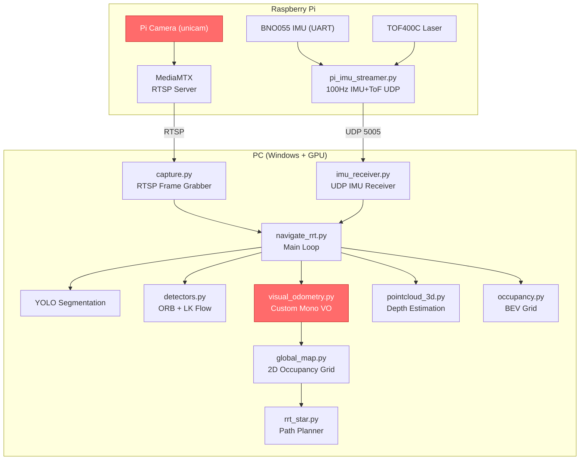
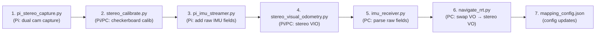

# ORB-SLAM3 Stereo-Inertial Migration Plan

## Goal
Migrate the robot's localization from the current **custom monocular Visual-Inertial Odometry** ([visual_odometry.py](file:///c:/Users/suwin/Documents/FIBO/Reoptimizedtracking/visual_odometry.py)) to **ORB-SLAM3 Stereo-Inertial** mode using two Logitech C930e webcams + the BNO055 IMU. This will permanently resolve the **forward/backward ambiguity** by providing metric-scale stereo depth and IMU-fused inertial preintegration.

## Current System Architecture



The red nodes are what we're **replacing**: the Pi Camera (monocular) and `visual_odometry.py` (custom VO with scale ambiguity).

---

## User Review Required

> [!IMPORTANT]
> **BNO055 Must Stream RAW Gyro + Accelerometer Data for ORB-SLAM3**
>
> Your current streamer uses **IMUPLUS fusion mode** (6-DOF on-chip fusion), which outputs Euler angles and fused linear acceleration. ORB-SLAM3's IMU preintegration engine requires **raw angular velocity (ω) and raw specific force (a) including gravity**. Feeding fused data will cause immediate tracking divergence.
>
> The Pi-side streamer must be modified to read raw gyro/accel registers from the BNO055 (or switch to a non-fusion operating mode like `AMG` / `ACCGYRO`), while still also reading Euler angles for your existing heading fallback.

> [!WARNING]
> **ORB-SLAM3 on Raspberry Pi 4 will run at 5–15 FPS**
>
> Full Stereo-Inertial ORB-SLAM3 at 640×480 on a Pi 4 (Cortex-A72) is computationally heavy. Options:
> 1. **Run ORB-SLAM3 on the Pi at reduced FPS** (reduce ORB features from 1000→500, accept 8–12 FPS)
> 2. **Run ORB-SLAM3 on the PC** (stream both stereo webcam feeds over network — adds latency)
> 3. **Use a lighter stereo VIO** (custom OpenCV pipeline or OpenVINS — fully in Python, ~15–20 FPS on Pi)
>
> Option 3 is recommended as a first step that keeps everything in your existing Python pipeline.

> [!CAUTION]
> **Logitech C930e Autofocus Must Be Disabled**
>
> Both webcams have autofocus which dynamically changes focal length. This will invalidate your calibration. You must lock focus on both cameras before calibration and at every boot.

---

## Open Questions

> [!IMPORTANT]
> **Q1: Where should the stereo VIO run?**
>
> - **Option A (Recommended):** Run a custom **Python stereo VIO on the Pi** — keeps the architecture simple, uses OpenCV `StereoSGBM` for disparity + `solvePnP` for motion, fused with BNO055. This replaces `visual_odometry.py` with a drop-in that outputs the same `(x, y, theta)` pose.
> - **Option B:** Build and run full **ORB-SLAM3 C++** on the Pi, write a Python wrapper or TCP bridge to feed poses to `navigate_rrt.py`.
> - **Option C:** Stream both cameras to the PC via RTSP/MJPEG and run stereo VIO on the PC (GPU-assisted).

> [!IMPORTANT]
> **Q2: Physical stereo baseline distance?**
>
> How far apart will you mount the two C930e cameras? Recommended: **8–12 cm** (similar to human inter-pupillary distance). This affects depth resolution at range — wider baseline = better depth at distance, but harder to match nearby objects.

> [!IMPORTANT]
> **Q3: Keep or remove the ToF sensor?**
>
> With stereo depth, the TOF400C becomes less critical for scale. However, it's still useful as a cross-check and emergency obstacle brake. We can keep the ToF integration alongside stereo.

---

## Proposed Changes

The migration is split into 6 components, ordered by dependency:

---

### Component 1: Stereo Camera Lock & Capture (Pi-side)

Scripts that run on the Raspberry Pi to capture synchronized frames from both C930e cameras.

#### [NEW] `pi_stereo_capture.py`

Dual-camera capture with:
- Synchronized frame grabbing from `/dev/video1` and `/dev/video3`
- **Autofocus disabled** (`v4l2-ctl --set-ctrl=focus_auto=0`)
- **Fixed exposure** across both cameras for stereo matching consistency
- MJPEG streaming of side-by-side stereo frames to the PC (or local processing)

```python
import cv2
import subprocess
import time

def lock_camera_settings(device_id):
    """Disable autofocus and auto-exposure on Logitech C930e."""
    dev = f"/dev/video{device_id}"
    subprocess.run(["v4l2-ctl", "-d", dev, "--set-ctrl=focus_auto=0"], check=False)
    subprocess.run(["v4l2-ctl", "-d", dev, "--set-ctrl=focus_absolute=30"], check=False)
    subprocess.run(["v4l2-ctl", "-d", dev, "--set-ctrl=exposure_auto=1"], check=False)  # Manual
    subprocess.run(["v4l2-ctl", "-d", dev, "--set-ctrl=exposure_absolute=200"], check=False)
    subprocess.run(["v4l2-ctl", "-d", dev, "--set-ctrl=white_balance_automatic=0"], check=False)

class StereoCapture:
    def __init__(self, left_id=1, right_id=3, width=640, height=480, fps=30):
        lock_camera_settings(left_id)
        lock_camera_settings(right_id)
        
        self.cap_left = cv2.VideoCapture(left_id, cv2.CAP_V4L2)
        self.cap_right = cv2.VideoCapture(right_id, cv2.CAP_V4L2)
        
        for cap in [self.cap_left, self.cap_right]:
            cap.set(cv2.CAP_PROP_FRAME_WIDTH, width)
            cap.set(cv2.CAP_PROP_FRAME_HEIGHT, height)
            cap.set(cv2.CAP_PROP_FPS, fps)
            cap.set(cv2.CAP_PROP_BUFFERSIZE, 1)
    
    def read(self):
        """Grab from both cameras as close in time as possible."""
        self.cap_left.grab()
        self.cap_right.grab()
        ret_l, frame_l = self.cap_left.retrieve()
        ret_r, frame_r = self.cap_right.retrieve()
        t = time.monotonic()
        return (ret_l and ret_r), frame_l, frame_r, t
    
    def release(self):
        self.cap_left.release()
        self.cap_right.release()
```

> [!NOTE]
> Using `.grab()` on both cameras before `.retrieve()` minimizes the time offset between left and right frames — critical for stereo accuracy on a moving robot.

---

### Component 2: Stereo Calibration

A one-time calibration script using a checkerboard pattern.

#### [NEW] `stereo_calibrate.py`

Captures synchronized checkerboard image pairs from both cameras, computes:
- **Intrinsic matrices** (K_left, K_right) and distortion coefficients
- **Stereo extrinsics** (R, T between cameras — T[0] = baseline distance)
- **Rectification maps** (R1, R2, P1, P2, Q)

Saves output to `stereo_calib.npz` and `stereo_slam_config.yaml` (ORB-SLAM3 compatible format).

```python
# Core calibration flow:
# 1. Capture 25-40 image pairs with checkerboard visible in BOTH cameras
# 2. findChessboardCorners() + cornerSubPix() on each pair
# 3. calibrateCamera() individually for intrinsics
# 4. stereoCalibrate() for R, T between cameras
# 5. stereoRectify() for rectification maps
# 6. Save everything to .npz + .yaml

# Checkerboard specs (user must provide):
BOARD_SIZE = (9, 6)      # inner corners (columns, rows)
SQUARE_SIZE_MM = 25.0    # physical size of each square in mm
```

Output files:
```
stereo_calib.npz        # NumPy archive with all matrices
stereo_slam_config.yaml # ORB-SLAM3 compatible YAML
```

**Calibration procedure the user must follow:**
1. Print a 10×7 or 9×6 checkerboard on A3/A4 paper, glue to rigid flat surface
2. Run the capture script, hold board at various angles/distances in front of **both** cameras
3. Capture at least 25 good pairs (script auto-detects and shows live preview)
4. Script computes calibration and reports reprojection error (target: < 0.5 px)

---

### Component 3: BNO055 Raw IMU Streaming (Pi-side)

> [!WARNING]
> This is the most critical change. Your current `pi_imu_streamer.py` reads from BNO055 in **IMUPLUS fusion mode** (register 0x1A = Euler angles). For ORB-SLAM3, we need **raw gyro + raw accel including gravity** from non-fusion registers.

#### [MODIFY] `pi_imu_streamer.py` / `pi_mpu6500_streamer.py`

The BNO055 driver's `update()` method currently reads:
- `0x16`: GYR_Y, GYR_Z (fused gyro in fusion mode)
- `0x1A`: Euler angles (heading/roll/pitch)
- `0x28`: Linear acceleration (gravity-removed)

**Changes needed:**

```python
# NEW: Read raw gyro (3-axis) from registers 0x14-0x19 (GYR_DATA_X_LSB)
# NEW: Read raw accel (3-axis, WITH gravity) from registers 0x08-0x0D (ACC_DATA_X_LSB)
# KEEP: Also read Euler angles for existing heading fallback

BNO055_REG_ACC_X = 0x08  # Raw accelerometer X LSB (includes gravity!)
BNO055_REG_GYR_X = 0x14  # Raw gyroscope X LSB

def update_raw(self, dt):
    """Read raw accel (with gravity) + raw gyro for ORB-SLAM3 preintegration."""
    # 20-byte burst: ACC_X(6) + MAG(6, skip) + GYR_X(6) + Euler(2, skip)
    raw = self._read_bytes(BNO055_REG_ACC_X, 20)
    
    ax_raw, ay_raw, az_raw = struct.unpack("<hhh", raw[0:6])
    gx_raw, gy_raw, gz_raw = struct.unpack("<hhh", raw[12:18])
    
    # BNO055 raw accel: 1 LSB = 1 m/s² (in default config)
    # BNO055 raw gyro: 1 LSB = 1/16 deg/s -> convert to rad/s
    ax = ax_raw / 100.0   # m/s² (includes gravity ~9.81 on Z)
    ay = ay_raw / 100.0
    az = az_raw / 100.0
    gx = math.radians(gx_raw / 16.0)  # rad/s
    gy = math.radians(gy_raw / 16.0)
    gz = math.radians(gz_raw / 16.0)
    
    return (ax, ay, az, gx, gy, gz)
```

**New packet format** (extended from 10 fields to 16):
```
seq, timestamp, yaw_deg, pitch_deg, roll_deg, gz_rads, gy_rads, lin_acc, calib, tof_m,
raw_ax, raw_ay, raw_az, raw_gx, raw_gy, raw_gz
```

This maintains **backward compatibility** — the first 10 fields stay the same for the existing pipeline, with 6 new raw IMU fields appended.

---

### Component 4: Stereo Visual-Inertial Odometry

This is the core replacement for `visual_odometry.py`. Two implementation options:

#### Option A (Recommended): Custom Python Stereo VIO

A drop-in replacement that outputs the same `(x, y, theta)` tuple, using:
1. **Stereo disparity** → metric depth map (no scale ambiguity!)
2. **ORB feature tracking** → 3D-to-2D PnP motion estimation with known depth
3. **BNO055 raw IMU fusion** → complementary filter combining visual pose with gyro/accel

#### [NEW] `stereo_visual_odometry.py`

```python
class StereoVisualOdometry:
    """
    Stereo Visual-Inertial Odometry with BNO055 fusion.
    Drop-in replacement for VisualOdometry — same API:
      .update(old_pts, new_pts, ...) -> (x, y, theta), (dx, dy, dtheta)
      .feed_imu(...)
    """
    
    def __init__(self, stereo_calib_file="stereo_calib.npz", ...):
        # Load stereo calibration
        calib = np.load(stereo_calib_file)
        self.K_left = calib["K_left"]
        self.K_right = calib["K_right"]
        self.dist_left = calib["dist_left"]
        self.dist_right = calib["dist_right"]
        self.R = calib["R"]          # Rotation between cameras
        self.T = calib["T"]          # Translation (baseline)
        self.map1_l, self.map2_l = ...  # Rectification maps
        self.map1_r, self.map2_r = ...
        
        self.baseline = abs(float(self.T[0]))  # meters
        self.stereo_matcher = cv2.StereoSGBM_create(
            minDisparity=0, numDisparities=64,
            blockSize=9, P1=8*3*9**2, P2=32*3*9**2,
            disp12MaxDiff=1, uniquenessRatio=10,
            speckleWindowSize=100, speckleRange=32
        )
        
        # Pose state (same as current VO)
        self.x = 0.0
        self.y = 0.0
        self.theta = math.pi / 2.0
    
    def compute_depth_map(self, frame_left, frame_right):
        """Rectify stereo pair and compute metric depth map."""
        rect_l = cv2.remap(frame_left, self.map1_l, self.map2_l, cv2.INTER_LINEAR)
        rect_r = cv2.remap(frame_right, self.map1_r, self.map2_r, cv2.INTER_LINEAR)
        
        gray_l = cv2.cvtColor(rect_l, cv2.COLOR_BGR2GRAY)
        gray_r = cv2.cvtColor(rect_r, cv2.COLOR_BGR2GRAY)
        
        disparity = self.stereo_matcher.compute(gray_l, gray_r).astype(np.float32) / 16.0
        
        # depth = (focal_length * baseline) / disparity
        valid = disparity > 0
        depth = np.zeros_like(disparity)
        depth[valid] = (self.fx * self.baseline) / disparity[valid]
        depth[depth > 5.0] = 0  # Clip far depth
        
        return depth, rect_l
    
    def update(self, old_pts, new_pts, depth_map, dt=1/30, ...):
        """Estimate motion from stereo depth + feature tracking."""
        # With stereo depth, we get METRIC 3D points → PnP gives METRIC motion
        # No scale ambiguity! No forward/backward ambiguity!
        # ... (3D-2D PnP with cv2.solvePnPRansac)
        pass
```

#### Option B: ORB-SLAM3 C++ with Python TCP Bridge

Build ORB-SLAM3 on the Pi, run it as a separate process, and communicate poses via TCP/shared memory.

```
┌─────────────────────────────────┐    TCP/IPC     ┌──────────────────────┐
│ ORB-SLAM3 C++ Process           │ ────────────── │ navigate_rrt.py      │
│ Stereo-Inertial Mode            │   (x,y,z,quat) │ (Python main loop)   │
│ Reads: /dev/video1, /dev/video3 │                │                      │
│ Reads: BNO055 raw IMU           │                │                      │
└─────────────────────────────────┘                └──────────────────────┘
```

---

### Component 5: IMU Receiver Update (PC-side)

#### [MODIFY] `imu_receiver.py`

Parse the 6 new raw IMU fields from the extended packet format:

```python
# In _parse_packet(), after parsing the first 10 fields:
if len(parts) >= 16:
    raw_ax = float(parts[10])  # m/s² (with gravity)
    raw_ay = float(parts[11])
    raw_az = float(parts[12])
    raw_gx = float(parts[13])  # rad/s
    raw_gy = float(parts[14])
    raw_gz = float(parts[15])
    sample["raw_accel"] = (raw_ax, raw_ay, raw_az)
    sample["raw_gyro"]  = (raw_gx, raw_gy, raw_gz)
```

---

### Component 6: Navigation Main Loop Integration

#### [MODIFY] `navigate_rrt.py`

Replace the monocular VO initialization and update with stereo VIO:

```python
# BEFORE (lines 226-234):
vo = VisualOdometry(
    camera_height_m=..., camera_pitch_deg=..., fov_deg=...,
    calib_file=cam_cfg["calib_file"], ...
)

# AFTER:
from stereo_visual_odometry import StereoVisualOdometry
vo = StereoVisualOdometry(
    stereo_calib_file="stereo_calib.npz",
    camera_height_m=..., camera_pitch_deg=...,
)
```

The stereo VO provides a **metric depth map** directly, eliminating the need for:
- `pointcloud_3d.py`'s `estimate_metric_depth()` (ground-plane + heuristic depth)
- ToF-based scale calibration (`calibrate_scale_from_tof`)
- The `metric_scale` variable entirely

The rest of the pipeline (`global_map.py`, `rrt_star.py`, motor control) stays **unchanged** — they only consume `(x, y, theta)` pose tuples.

---

### Component 7: Configuration Updates

#### [MODIFY] `mapping_config.json`

Add stereo camera configuration section:

```json
{
  "stereo_camera": {
    "left_device_id": 1,
    "right_device_id": 3,
    "resolution_w": 640,
    "resolution_h": 480,
    "fps": 30,
    "calib_file": "stereo_calib.npz",
    "disable_autofocus": true,
    "stereo_num_disparities": 64,
    "stereo_block_size": 9
  },
  "imu_raw": {
    "stream_raw_accel_gyro": true,
    "bno055_operating_mode": "AMG",
    "imu_frequency_hz": 100
  }
}
```

---

## Implementation Order & File Manifest



| # | File | Location | Action | Description |
|---|------|----------|--------|-------------|
| 1 | `pi_stereo_capture.py` | Pi | **NEW** | Synchronized dual C930e capture + autofocus lock |
| 2 | `stereo_calibrate.py` | Pi or PC | **NEW** | Checkerboard stereo calibration → `.npz` + `.yaml` |
| 3 | `pi_imu_streamer.py` | Pi | **MODIFY** | Add raw accel/gyro registers to BNO055 burst read + extend packet |
| 4 | `stereo_visual_odometry.py` | Pi or PC | **NEW** | Stereo VIO with metric depth + BNO055 fusion (drop-in for `visual_odometry.py`) |
| 5 | `imu_receiver.py` | PC | **MODIFY** | Parse new raw IMU fields (backward compatible) |
| 6 | `navigate_rrt.py` | PC | **MODIFY** | Swap `VisualOdometry` → `StereoVisualOdometry` |
| 7 | `mapping_config.json` | Both | **MODIFY** | Add `stereo_camera` and `imu_raw` config sections |

---

## Verification Plan

### Phase 1: Camera Hardware Verification

```bash
# On Pi: Verify simultaneous capture works
python3 pi_stereo_capture.py --test

# Expected: Both cameras output (480, 640, 3) at 30 FPS
# Verify: Autofocus locked, consistent exposure between cameras
```

### Phase 2: Stereo Calibration Verification

```bash
# On Pi: Run calibration with checkerboard
python3 stereo_calibrate.py --board-size 9x6 --square-size 25

# Verify:
# - Reprojection error < 0.5 pixels
# - Baseline (T[0]) matches physical measurement ± 2mm
# - Rectified images show horizontally aligned epipolar lines
```

Manual check: Display rectified stereo pair with horizontal lines overlaid — corresponding points should lie on the same horizontal scanline.

### Phase 3: Stereo Depth Verification

```bash
# On Pi: Compute and display disparity map
python3 stereo_visual_odometry.py --test-depth

# Verify:
# - Disparity map shows smooth gradients (near=bright, far=dark)
# - Known objects at measured distances report correct depth ± 5%
# - No significant stereo artifacts (streaking, holes)
```

### Phase 4: Motion Estimation Verification

```bash
# On Pi: Drive robot forward 1.0m in a straight line
# Compare reported VO displacement vs tape-measured distance

# Verify:
# - Forward motion correctly reported as positive dy
# - Backward motion correctly reported as negative dy (THE BIG FIX)
# - Rotation matches BNO055 heading within ±2°
```

### Phase 5: Full Pipeline Integration Test

```bash
# On PC: Run full navigation pipeline with stereo VO
python navigate_rrt.py --source pi --config mapping_config.json

# Verify:
# - Robot trajectory on global map matches physical path
# - No forward/backward oscillation in pose estimate
# - Obstacle avoidance still works (stereo depth → occupancy grid)
# - RRT* path planning unaffected
```

### Automated Smoke Tests

```bash
# Verify stereo calibration file integrity
python3 -c "
import numpy as np
d = np.load('stereo_calib.npz')
assert 'K_left' in d and 'K_right' in d and 'T' in d
baseline = abs(d['T'][0])
assert 0.05 < baseline < 0.20, f'Baseline {baseline}m out of range'
print(f'Calibration OK: baseline={baseline:.4f}m')
"

# Verify backward-compatible IMU packet parsing
python3 -c "
from imu_receiver import BNO055Receiver
r = BNO055Receiver(udp_port=0)
# Simulate old 10-field packet
r._parse_packet('1,1234.5,180.00,5.00,0.50,0.1234,0.0200,0.450,3,-1.000')
assert len(r.buffer) == 1
print('Old packet format: OK')

# Simulate new 16-field packet  
r._parse_packet('2,1234.6,180.00,5.00,0.50,0.1234,0.0200,0.450,3,-1.000,0.12,-0.05,9.78,0.001,-0.002,0.003')
s = r.buffer[-1]
assert 'raw_accel' in s or len(r.buffer) == 2  # Updated parser handles it
print('New packet format: OK')
"
```
